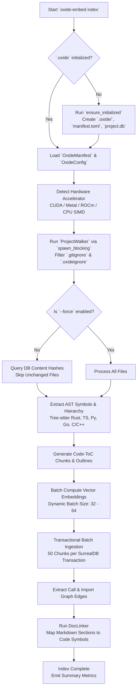
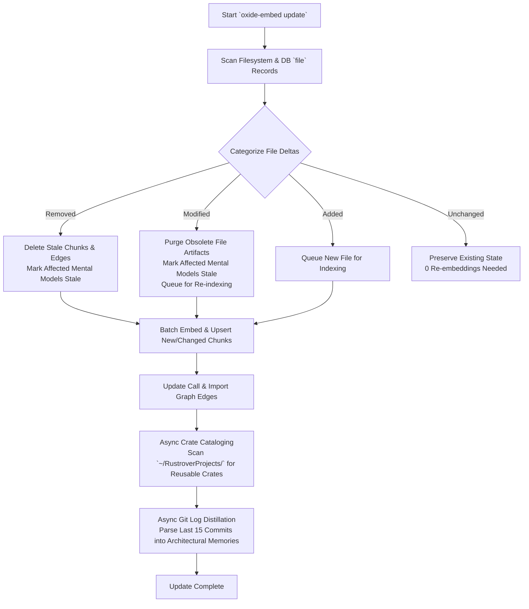
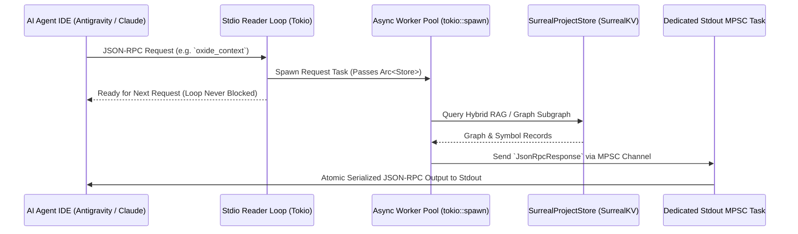

# Oxide-embed Application Execution Flows

This document details the internal runtime lifecycles and operational workflows of **Oxide-embed**.

---

## 1. Workspace Indexing Flow (`oxide-embed index`)



### Steps:
1. **Auto-Initialization**: If the target directory lacks an `.oxide` metadata folder, `ensure_initialized` automatically creates the workspace manifest, configuration, and embedded SurrealKV database.
2. **Hardware Probe**: Automatically selects the highest available compute accelerator (`cuda:0`, `metal:0`, or CPU SIMD) and configures optimal batch sizes.
3. **Non-Blocking Walk**: Offloads filesystem crawling to `tokio::task::spawn_blocking` to preserve Tokio worker availability.
4. **AST Extraction**: Slices source files along syntax boundaries into structural macro nodes and leaf functions.
5. **SurrealKV Multi-Statement Ingestion**: Ingests chunks in atomic 50-chunk transactions via `upsert_chunks_batch`, reducing fsync commits by 50x.

---

## 2. Incremental Delta Synchronization Flow (`oxide-embed update`)



### Operational Highlights:
- **Zero Redundant Embedding**: Files matching the stored SHA-256 content hash bypass tokenization and embedding entirely.
- **Artifact Cleansing**: Modified and deleted files have their old AST symbols, doc linkages, and call edges removed atomically.
- **Mental Model Stale Tracking**: Any mental model that references a modified or deleted file is flagged as stale (`is_stale = true`).
- **Cross-Crate Anti-Duplication**: Discovers sibling local crates and updates `crate_catalog` so agents do not reinvent existing modules.

---

## 3. Cognitive Reflection & Query Flow (`oxide-embed reflect`)

```mermaid
flowchart TD
    A[Incoming Task / Inquiry] --> B{Check Standing Mental Models\nExact Topic Match?}
    B -- Hit & Fresh --> C[Return Standing Pre-Synthesized Answer\nLatency < 500 µs]
    B -- Hit & Stale --> D[Trigger Stale Model Re-synthesis]
    B -- Miss --> E[Initiate 4-Way Reciprocal Rank Fusion]
    D --> E
    E --> F1[Dense Vector Retrieval\nKNN Cosine Similarity]
    E --> F2[Lexical STAIR Retrieval\nBM25 Code-ToC Leaf Matches]
    E --> F3[GraphRAG 2-Hop BFS\nCallers, Callees, Symbol Parents]
    E --> F4[Temporal Memory Recall\nEbbinghaus Decay Curve Applied]
    F1 & F2 & F3 & F4 --> G[Fuse via RrfScorer\n`RRF_score = Σ 1 / (60 + rank)`]
    G --> H[Pack into Greedy Knapsack\nStrict Token Budget Enforcement]
    H --> I[Synthesize Grounded Answer & Citations]
```

---

## 4. Non-Blocking MCP Stdio Event Pipeline


