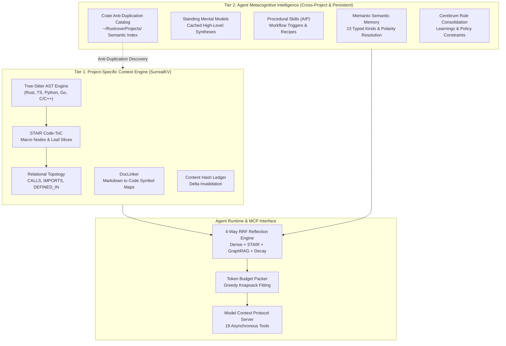
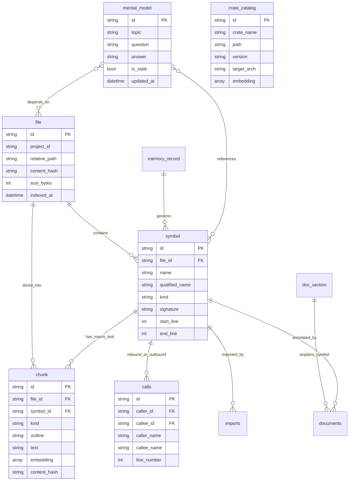
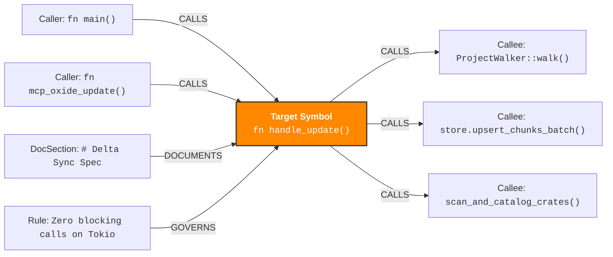

# Oxide-embed Architectural & Schema Diagrams

This document contains visual diagrams depicting the architecture, data schemas, memory layers, and graph topologies of **Oxide-embed**.

---

## 1. Dual-Tier Cognitive Memory Fabric



---

## 2. SurrealDB Multi-Model Schema & Graph Relational Diagram



---

## 3. GraphRAG 2-Hop Subgraph Topology



---

## 4. STAIR Code-ToC Hierarchical Breadcrumb Structure

```mermaid
graph TD
    File["File: <code>crates/oxide-db/src/surreal.rs</code>"]
    Macro["Macro Node: <code>impl ProjectStore for SurrealProjectStore</code>"]
    Leaf1["Leaf Node: <code>async fn upsert_chunks_batch()</code>"]
    Leaf2["Leaf Node: <code>async fn get_subgraph()</code>"]
    Leaf3["Leaf Node: <code>async fn search_hybrid()</code>"]

    File --> Macro
    Macro -->|Breadcrumb: [impl ProjectStore > upsert_chunks_batch]| Leaf1
    Macro -->|Breadcrumb: [impl ProjectStore > get_subgraph]| Leaf2
    Macro -->|Breadcrumb: [impl ProjectStore > search_hybrid]| Leaf3
```
